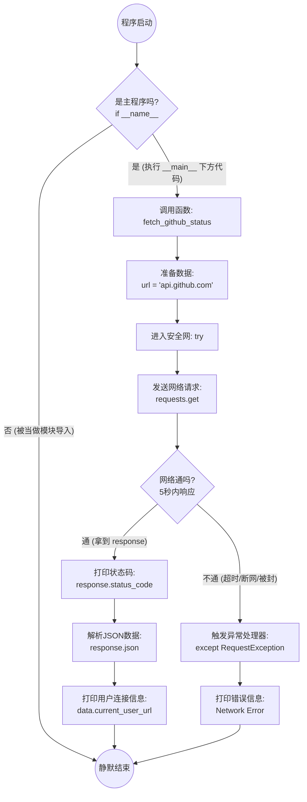
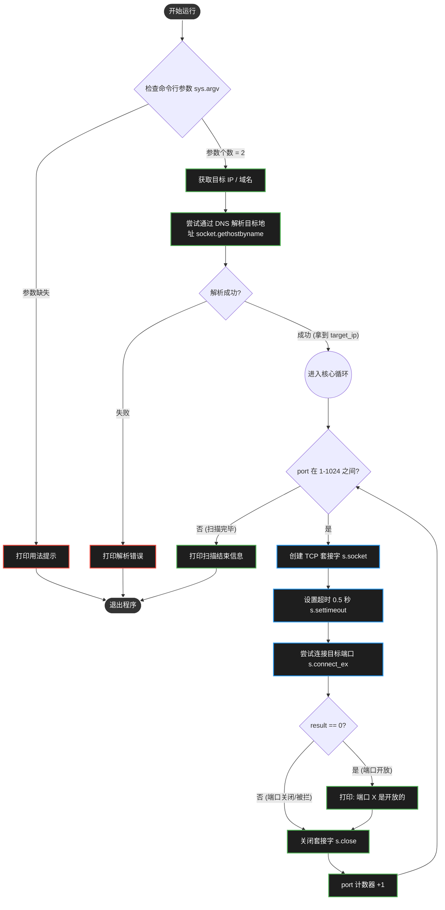

# Test Requests




 # Port Scanner



 # OS Tests

```mermaid
graph TD
    %% 定义节点样式
    classDef startEnd fill:#333,stroke:#fff,stroke-width:2px,color:#fff;
    classDef process fill:#1e1e1e,stroke:#4CAF50,stroke-width:2px,color:#fff;
    classDef decision fill:#1e1e1e,stroke:#FF9800,stroke-width:2px,color:#fff;
    classDef action fill:#1e1e1e,stroke:#2196F3,stroke-width:2px,color:#fff;
    classDef danger fill:#1e1e1e,stroke:#f44336,stroke-width:2px,color:#fff;

    %% 流程开始
    Start([开始系统侦察 System Recon]) --> LogStart[打印侦察开始分割线]
    
    %% 身份检查
    LogStart --> GetUser[调用 getpass 获取当前用户身份]
    GetUser --> TryUser{获取成功?}
    TryUser -- "成功" --> PrintUser[打印: 当前用户身份]
    TryUser -- "失败 (异常捕获)" --> UserError[打印: 无法确定用户身份]
    UserError --> GetOS
    PrintUser --> GetOS
    
    %% 操作系统指纹提取
    GetOS[调用 platform 获取系统内核与架构信息] --> PrintOS[打印: 系统类型 / 内核版本 / 架构]
    
    %% 环境变量扫描 (高价值情报)
    PrintOS --> ScanEnv[遍历环境变量字典 os.environ.items]
    ScanEnv --> CheckEnvKey{变量名包含 secret / key / pass?}
    
    CheckEnvKey -- "是 (命中敏感词汇)" --> PrintEnv[高亮打印: 发现潜在敏感数据]
    CheckEnvKey -- "否 (忽略)" --> NextEnv
    PrintEnv --> NextEnv[继续遍历下一个变量]
    
    NextEnv --> EnvDone{遍历结束?}
    EnvDone -- "否" --> ScanEnv
    EnvDone -- "是" --> ShellExec
    
    %% 系统命令执行 (核心杀伤力)
    ShellExec[执行系统级 Shell 命令 os.popen] --> GetPWD[获取当前工作目录 pwd]
    GetPWD --> PrintPWD[打印: 当前目录路径]
    
    PrintPWD --> CheckNC[检查是否安装了 Netcat which nc]
    CheckNC --> NCResult{Netcat 存在?}
    
    NCResult -- "是" --> PrintNC[打印: Netcat 路径]
    NCResult -- "否" --> PrintNoNC[打印: 未发现 Netcat]
    
    PrintNC --> EndLine
    PrintNoNC --> EndLine
    
    %% 流程结束
    EndLine[打印侦察结束分割线] --> Exit([退出程序])

    %% 绑定样式
    class Start,Exit startEnd;
    class LogStart,GetUser,PrintUser,GetOS,PrintOS,ScanEnv,NextEnv,GetPWD,PrintPWD,EndLine process;
    class TryUser,CheckEnvKey,EnvDone,NCResult decision;
    class ShellExec,CheckNC action;
    class UserError,PrintEnv,PrintNC,PrintNoNC danger;
```



 # File Automation

 ```mermaid
 graph TD
    %% 定义节点样式
    classDef startEnd fill:#333,stroke:#fff,stroke-width:2px,color:#fff;
    classDef process fill:#1e1e1e,stroke:#4CAF50,stroke-width:2px,color:#fff;
    classDef decision fill:#1e1e1e,stroke:#FF9800,stroke-width:2px,color:#fff;
    classDef action fill:#1e1e1e,stroke:#2196F3,stroke-width:2px,color:#fff;
    classDef danger fill:#1e1e1e,stroke:#f44336,stroke-width:2px,color:#fff;

    %% 流程开始
    Start([开始执行脚本]) --> DefineFunc[定义 hunt_for_passwords 函数]
    DefineFunc --> Trigger[接收参数 target_dir]
    Trigger --> StartHunt[打印: 开始扫描目标目录]
    
    %% 目录遍历核心
    StartHunt --> Walk[使用 os.walk 遍历目录树 root, dirs, files]
    Walk --> CheckFiles{当前目录下有文件吗?}
    
    CheckFiles -- "有" --> LoopFiles[遍历当前目录的每一个文件]
    CheckFiles -- "无" --> NextDir[进入下一个子目录]
    
    %% 文件类型过滤
    LoopFiles --> CheckExt{文件名后缀是 .txt 或 .log?}
    CheckExt -- "否" --> LoopFiles
    CheckExt -- "是" --> JoinPath[拼接完整文件路径 os.path.join]
    
    %% 尝试读取文件
    JoinPath --> TryOpen[尝试打开文件 with open...]
    TryOpen --> OpenResult{权限够吗/能打开吗?}
    
    OpenResult -- "失败 (抛出异常)" --> IgnoreFile[直接忽略该文件]
    IgnoreFile --> LoopFiles
    OpenResult -- "成功" --> LoopLines[逐行读取文件内容]
    
    %% 内容匹配
    LoopLines --> CheckKeyword{行内容包含 'password'?}
    CheckKeyword -- "是 (命中目标)" --> PrintResult[高亮打印: 发现潜在凭据]
    CheckKeyword -- "否" --> NextLine[读取下一行]
    
    PrintResult --> NextLine
    NextLine --> LoopLines
    
    %% 清理与结束
    NextDir --> Walk
    Walk --> ScanEnd{所有目录遍历完毕?}
    ScanEnd -- "否" --> Walk
    ScanEnd -- "是" --> Exit([扫描结束])

    %% 绑定样式
    class Start,Exit startEnd;
    class DefineFunc,Trigger,StartHunt,Walk,LoopFiles,JoinPath,LoopLines,NextLine,NextDir process;
    class CheckFiles,CheckExt,OpenResult,CheckKeyword,ScanEnd decision;
    class TryOpen action;
    class IgnoreFile,PrintResult danger;
```

# Log Parser
```mermaid
graph TD
    %% 定义节点样式
    classDef startEnd fill:#333,stroke:#fff,stroke-width:2px,color:#fff;
    classDef process fill:#1e1e1e,stroke:#4CAF50,stroke-width:2px,color:#fff;
    classDef decision fill:#1e1e1e,stroke:#FF9800,stroke-width:2px,color:#fff;
    classDef action fill:#1e1e1e,stroke:#2196F3,stroke-width:2px,color:#fff;
    classDef danger fill:#1e1e1e,stroke:#f44336,stroke-width:2px,color:#fff;
    classDef note fill:#1e1e1e,stroke:#9E9E9E,stroke-width:2px,stroke-dasharray: 5 5,color:#9E9E9E;

    %% 流程开始
    Start([开始执行]) --> DefFunc[定义 extract_flag 函数]
    DefFunc --> GetInput[接收参数: 日志文本 log_data]
    
    %% 正则准备
    GetInput --> CompileRegex[编译正则表达式 re.search]
    
    %% 用双引号包裹包含花括号的文本
    RegexNote("正则逻辑: 匹配 flag\{...\} 格式"):::note
    CompileRegex -.-> RegexNote
    
    %% 执行搜索
    CompileRegex --> DoSearch[在 log_data 中扫描匹配项]
    DoSearch --> CheckMatch{找到匹配内容?}
    
    %% 结果处理
    CheckMatch -- "是 (Match Object)" --> Extract[使用 .group 提取完整 Flag]
    Extract --> ReturnFlag[返回: 提取到的 Flag 字符串]
    
    CheckMatch -- "否 (None)" --> ReturnNone[返回: 未找到 Flag 的提示]
    
    %% 主程序入口
    ReturnFlag --> MainBlock
    ReturnNone --> MainBlock
    
    MainBlock["if __name__ == '__main__' 判断"] --> PrintResult[打印最终结果到终端]
    PrintResult --> Exit([退出程序])

    %% 绑定样式
    class Start,Exit startEnd;
    class DefFunc,GetInput,CompileRegex,DoSearch,Extract,ReturnFlag,MainBlock,PrintResult process;
    class CheckMatch decision;
    class ReturnNone danger;
    ```